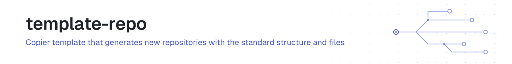

<!-- brand:header:start -->
<picture>
  <source media="(prefers-color-scheme: dark)" srcset="assets/brand/header-9161af12-dark.svg">
  
</picture>
<!-- brand:header:end -->

[](https://codecov.io/gh/JonathanTSilva/template-repo)
[](https://sonarcloud.io/summary/new_code?id=JonathanTSilva_template-repo)

The [Copier](https://copier.readthedocs.io) template that every active repository of JonathanTSilva is rendered from. It produces the README, LICENSE, `AGENTS.md`, `CLAUDE.md`, the `.claude` settings and agents, CI, Dependabot, the dev container and the other files in the GitHub standard.

This is not a GitHub template repository. "Use this template" would copy unrendered Jinja, so new repositories are created with `jts-ops new`, which renders this template.

## Use it

Render into a new directory:

```sh
uvx copier copy gh:JonathanTSilva/template-repo path/to/new-repo
```

Re-sync an existing repository after the standard changes:

```sh
uvx copier update
```

Rendering writes `.copier-answers.yml`, which `copier update` reads.

### After rendering: lock the dependencies

A lockfile cannot be rendered, and the shared CI installs with a frozen lockfile. Create it once, then commit it with the rest:

```sh
uv lock                                   # stack: python
npx --yes pnpm@9 install --lockfile-only  # stack: node
```

`jts-ops new` does this automatically. The other stacks need no lockfile (the `rust` skeleton ships its `Cargo.lock`).

## README brand

The rendered README starts with a brand header and ends with a shared footer button, each between `<!-- brand:header:start -->` / `<!-- brand:header:end -->` and `<!-- brand:footer:start -->` / `<!-- brand:footer:end -->` markers. The header points at `assets/brand/header-PLACEHOLDER-{light,dark}.svg`, which do not exist yet: `jts-ops new` and `jts-ops adopt` run `jts-ops brand`, which generates the header SVGs (transparent, light and dark, named by a hash of the repo name and description) and rewrites only the two marker blocks. To regenerate a header after a rename or description change, run `jts-ops brand <repo> --execute`. The footer button is hosted in [`.github`](https://github.com/JonathanTSilva/.github/tree/main/assets/brand).

## Questions

| Question | Values |
|---|---|
| `repo_name` | Lowercase kebab-case, `^[a-z0-9]+(-[a-z0-9]+)*$` |
| `description` | One line, also used for the GitHub description |
| `kind` | One of the kind ids in [`standard.yml`](https://github.com/JonathanTSilva/.github/blob/main/standard.yml) |
| `stack` | `python`, `node`, `shell`, `go`, `rust`, `c-cpp`, `latex` or `none` |
| `visibility` | `public` or `private`. Private repos get static badges only |
| `license` | `mit`, `cc-by-4.0`, `mit+cc-by-4.0`, `proprietary`, `agpl-3.0`. Company-owned repos keep the company license and are not rendered from this template |
| `status` | `concept`, `wip`, `active` or `inactive` |
| `has_release` | Adds the release-please job and the release badge |
| `year` | Copyright year, defaults to the current year |
| `skeleton` | `true` by default. Set `false` to skip the project skeleton below when adopting an existing repo |
| `e2e` | Adds the Playwright job (`e2e.yml`). Default `false` |
| `lighthouse` | Adds the Lighthouse CI job (`lighthouse.yml`). Default `false` |
| `load` | Adds the k6 load-test job (`load.yml`). Default `false` |
| `bench` | Adds the benchmark job with history on `gh-pages` (`bench.yml`). Default `false` |
| `reports` | Adds the Allure report job (`reports.yml`). Default `false` |
| `sonar` | Adds the SonarQube Cloud quality-gate badge on public repos. No CI job: the project uses Automatic Analysis. Default `false` |

The suite flags only add a job to `ci.yml` (adjust its inputs after rendering) and default to `false`, so `copier update` never changes an existing repo's jobs. Public `python` and `go` repos also get a `coverage` job (Codecov through OIDC) and the coverage badge.

## What you get

Every stack: `README.md`, `LICENSE`, `AGENTS.md`, `CLAUDE.md` (only `@AGENTS.md`), `.claude/settings.json`, `.claude/agents/` (`architect` on Opus, `builder` on Sonnet, `mechanic` on Haiku), `.editorconfig`, `.gitignore`, `.markdownlint-cli2.yaml`, `.pre-commit-config.yaml`, `.github/workflows/ci.yml`, `.github/dependabot.yml`, `.github/CODEOWNERS`, `.devcontainer/devcontainer.json` and `.copier-answers.yml`.

A minimal project skeleton, so a new repo starts with green CI:

| Stack | Skeleton |
|---|---|
| `python` | `pyproject.toml` (`uv_build`, ruff, pyright strict, pytest with coverage), `.python-version`, `src/<package>/__init__.py`, `tests/test_smoke.py` |
| `node` | `package.json` (ESM, `packageManager` pnpm 9, `lint`, `typecheck` and `test` scripts), `eslint.config.js`, `tsconfig.json`, `src/index.ts`, `tests/index.test.ts` |
| `shell` | `bin/<repo>.sh` (with `--help`), `test/<repo>.bats` |
| `go` | `go.mod`, `sum.go`, `sum_test.go` |
| `rust` | `Cargo.toml`, `Cargo.lock`, `src/lib.rs` |
| `c-cpp` | `CMakeLists.txt` (C++17, ctest, warnings as errors), `src/sum.{hpp,cpp}`, `tests/sum_test.cpp` |
| `latex` | `main.tex` |
| `none` | nothing |

Skeleton files are listed in `_skip_if_exists`, so rendering onto an existing repo never overwrites real code.

`ci.yml` calls the reusable workflows in [`.github`](https://github.com/JonathanTSilva/.github) at `@v1` and ends with one aggregator job named `ci`, the single check a ruleset requires.

Community files (code of conduct, contributing, security policy, issue forms, PR template) are not rendered. They come from the `.github` defaults.

## Develop

```sh
uv run pytest -q
```

The tests render the template for each stack from the committed `HEAD`, so commit before running them. They read the list of required files from the `.github` repository, expected at `../.github` or at the path in `JTS_STANDARD_DIR`. Without a checkout there (CI, a fresh clone) they use the vendored copy `tests/fixtures/standard.yml`; copy `standard.yml` over it when the standard changes, a test fails when they differ.

License texts live in `licenses/` and are included by `template/LICENSE.jinja`.

## Docs

The conventions are in the [handbook](https://github.com/JonathanTSilva/.github/blob/main/handbook/README.md), in particular [repo anatomy](https://github.com/JonathanTSilva/.github/blob/main/handbook/repo-anatomy.md).

## Contributing

See the [contributing guide](https://github.com/JonathanTSilva/.github/blob/main/CONTRIBUTING.md).

## License

MIT. See [LICENSE](LICENSE). Rendered repositories get the license you choose.

<!-- brand:footer:start -->
<p align="right"><a href="https://www.jontobias.com"><picture>
  <source media="(prefers-color-scheme: dark)" srcset="https://raw.githubusercontent.com/JonathanTSilva/.github/main/assets/brand/jontobias-dark.svg">
  
</picture></a></p>
<!-- brand:footer:end -->
